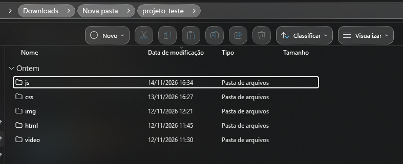

# UnipeBurguer

Projeto final de Desenvolvimento Front-End para Web. O site apresenta uma hamburgueria e permite montar um pedido simulado no navegador.

## Objetivo e minha contribuição

Organizei as páginas de início, cardápio, cupons, carrinho, sobre nós e contato. Usei HTML e CSS para a estrutura e o visual. Com JavaScript, fiz a adição de produtos ao carrinho, a mudança de quantidades, o cálculo do subtotal e dos descontos, a cópia de cupons e a troca das avaliações.

## Como testar

1. Baixe o repositório e abra index.html no navegador.
2. Entre no [cardápio](cardapio/index.html) e adicione um produto.
3. Abra o [carrinho](carrinho/index.html), altere a quantidade e confira o subtotal.
4. Veja os códigos em [cupons](cupons/index.html), digite um no carrinho e confira o desconto.
5. Preencha o endereço e finalize para ver a confirmação simulada.

## Estrutura

| Pasta | Conteúdo |
| --- | --- |
| index.html | Página inicial |
| cardapio/, carrinho/, cupons/, sobrenos/, contato/ | Demais páginas |
| css/ | Estilos |
| js/ | Carrinho, cupons, avaliações e contato |
| img/ e video/ | Imagens e vídeo do site |

## Evidências

- [Cardápio](cardapio/index.html): produtos e botões de adicionar.
- [Carrinho](carrinho/index.html) e [JavaScript do pedido](js/pedido.js): itens, quantidades, cupom, total e confirmação.
- [Cupons](cupons/index.html) e [JavaScript dos cupons](js/cupons.js): códigos e botão de copiar.
- [Página inicial](index.html) e [avaliações](js/avaliacoes.js): apresentação e navegação entre depoimentos.

## Limitações conhecidas

O pedido é uma simulação: não há pagamento, servidor ou envio para a hamburgueria. Os itens do carrinho ficam salvos no navegador com localStorage. O endereço digitado não é salvo.

## O que melhorei hoje e próximo ajuste

Atualizei o README com o objetivo, minha contribuição, evidências e limitações do projeto. Meu próximo ajuste será praticar JavaScript em um projeto pequeno de lista de tarefas.

## Sobre os commits

Professor, comecei o projeto alguns dias antes em outra pasta no computador. Faltei à última aula e soube depois, pelos meus colegas, que precisava registrar commits todos os dias. Por isso, parte do trabalho local não aparece no início do histórico do GitHub. Entendo que isso pode afetar a avaliação.

João Gabriel Gonçalves - 2026
